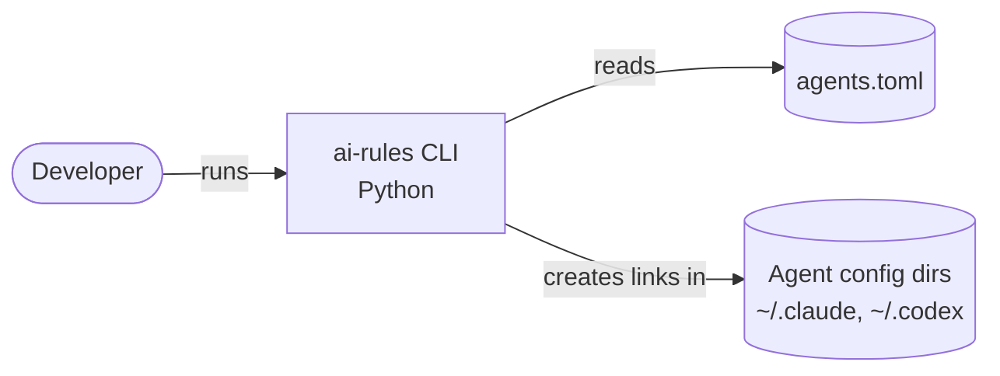

# Diagrams

Add a diagram only when it explains something faster than text: structure, flow, states, order of messages. Every diagram supports the text; it never replaces it.

## Diagrams as code

- Write diagrams as text in the repository, reviewed and diffed like code. **Mermaid** by default: GitHub, GitLab and most Markdown tools render it inline.
- Other text formats only for a need Mermaid does not cover (PlantUML for detailed UML, Graphviz for large generated graphs, D2), with the user's agreement.
- No binary-only diagrams. If an image is required (slides, external tools), keep its source next to it and export it from that source.

## Pick the diagram

| To show | Diagram | Mermaid |
|---|---|---|
| The system in its environment: users, external systems | C4 level 1, system context | `flowchart` (or `C4Context`, experimental) |
| The deployable parts and how they talk | C4 level 2, containers | `flowchart` with subgraphs |
| The parts inside one container | C4 level 3, components (only when it helps) | `flowchart` |
| An interaction over time between parts | Sequence diagram | `sequenceDiagram` |
| A process or a decision path | Flowchart | `flowchart` |
| The lifecycle of an object or a request | State diagram | `stateDiagram-v2` |
| A data model | Entity-relationship | `erDiagram` |
| Classes and their relations (rarely needed) | Class diagram | `classDiagram` |
| A schedule or a plan | Gantt | `gantt` |
| Where things run | Deployment (C4 deployment view) | `flowchart` |

**C4 vocabulary** (Simon Brown, <https://c4model.com/>): four abstractions, software system, container (an application or a data store that runs on its own), component and code, plus the people who use the systems. Name each box with its name, its type and its technology; label each arrow with what it does ("reads config from", "sends events to") and the protocol when it matters.

## Rules

- One diagram, one question. Five to fifteen elements; split a bigger one by level or by scenario.
- A title and a legend when shapes or colours carry meaning; do not rely on colour alone (accessibility).
- **A text description** under each diagram: one or two sentences with the main point, for readers who cannot see it and for search.
- Diagrams describe the code as it is: update them in the same commit as a structural change, or delete them.
- Validate the syntax before committing (see [tooling](tooling.md)): a diagram that fails to render is a broken document.

## Example

The developer runs the CLI, which reads `agents.toml` and links each agent's configuration directory to the repository.
